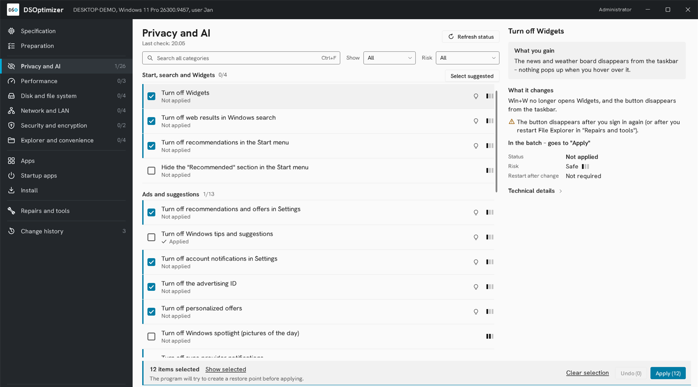

  

<h1 align="center">DSOptimizer</h1>

Free, open-source cleanup for a fresh Windows 11. 
Remove preinstalled apps, turn off ads, telemetry and AI features, and see the state of every setting before you change it.

  <a href="https://github.com/ds99-01/DSOptimizer/releases/latest"><b>Download</b></a> &nbsp;·&nbsp;
  <a href="https://dsoptimizer.com/">Website</a> &nbsp;·&nbsp;
  <a href="https://dsoptimizer.com/docs/">Every item explained</a> &nbsp;·&nbsp;
  <a href="README.pl.md">Polski</a>

  
  

## How it works

1. **It reads first.** Each item shows "Applied" or "Not applied". Nothing is selected and nothing changes yet.
2. **You choose.** Select items or click "Select suggested". Each item says what you gain and what it changes.
3. **It applies and records.** Before the change it tries to create a restore point. Every change goes to the Change history, where settings can be undone. App removals and repairs cannot be undone, and the program says so next to each of them.

Besides privacy and AI settings, the program removes preinstalled apps, installs popular programs through winget, manages startup apps and runs common repairs, such as Windows Update reset and system file repair. The full list is in [the details](docs/en/details.md#whats-inside).

## Proof, not promises

| Claim | How to check it |
|---|---|
| No telemetry, no self-updates | [Network measurement, version 4.0.6](docs/zrodla/2026-11-08-v4-0-6-pomiar-sieci.md) (in Polish) |
| The file you downloaded is the one that was built | `SHA256SUMS.txt` in every release |
| Microsoft Defender does not flag it | [Antivirus report, version 4.0.1](docs/zrodla/2026-10-30-v4-0-1-raport-antywirus.md) (in Polish) |
| You can read and build the code | This repository, MPL 2.0: `dotnet build DSOptimizer.sln -c Release` |
| It leaves Defender, UAC and SmartScreen alone | [Security page](https://dsoptimizer.com/security/) |

## Download

| File | What it is |
|---|---|
| `DSOptimizer-<version>.zip` | Portable: unpack and run, also from a USB drive |
| `DSOptimizer-<version>-setup.exe` | Installer into Program Files, with Start menu shortcut |

Windows 11 x64 and an administrator account. Tested on Windows 11 26H2 Home and Pro, in English and Polish.
Compare the file with `SHA256SUMS.txt` from the same release: `Get-FileHash .\DSOptimizer-<version>.zip`.

> [!NOTE]
> The files are not digitally signed yet, so the first time Windows shows "Windows protected your PC".
> Check the checksum, then click "More info" and "Run anyway".

## More

- [Details](docs/en/details.md): language, requirements, download and installer, privacy, what can and cannot be undone
- [Command-line mode](docs/en/cli.md): commands, exit codes, JSON report, building from source
- [Every item explained](https://dsoptimizer.com/docs/): what you gain, what it changes, risk, technical details

## License

Mozilla Public License 2.0, see [LICENSE](LICENSE). The DSOptimizer name and the DŚO mark are not covered by the license; modified versions must use a different name.
Third-party libraries and fonts: [THIRD_PARTY_NOTICES_EN.md](THIRD_PARTY_NOTICES_EN.md).

Made by Dawid Świeboda ([github.com/ds99-01](https://github.com/ds99-01)). Questions: [contact@dsoptimizer.com](mailto:contact@dsoptimizer.com) · Security: [security@dsoptimizer.com](mailto:security@dsoptimizer.com) · Support: [GitHub Sponsors](https://github.com/sponsors/ds99-01) or [buycoffee.to](https://buycoffee.to/dsoptimizer), voluntary, unlocks nothing.
