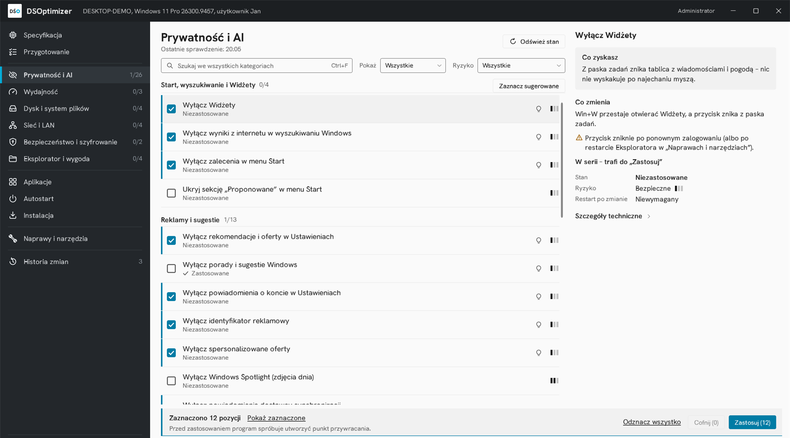

  

<h1 align="center">DSOptimizer</h1>

Darmowy program z otwartym kodem do porządków w świeżym Windows 11. 
Usuwa zbędne aplikacje, wyłącza reklamy, telemetrię i funkcje AI, a stan każdego ustawienia pokazuje przed zmianą.

  <a href="https://github.com/ds99-01/DSOptimizer/releases/latest"><b>Pobierz</b></a> &nbsp;·&nbsp;
  <a href="https://dsoptimizer.com/pl/">Strona</a> &nbsp;·&nbsp;
  <a href="https://dsoptimizer.com/pl/dokumentacja/">Opis każdej pozycji</a> &nbsp;·&nbsp;
  <a href="README.md">English</a>

  
  

## Jak to działa

1. **Najpierw tylko sprawdza.** Przy każdej pozycji widać „Zastosowane” albo „Niezastosowane”. Nic nie jest zaznaczone i nic się jeszcze nie zmienia.
2. **Ty wybierasz.** Zaznaczasz pozycje albo klikasz „Zaznacz sugerowane”. Przy każdej pozycji jest napisane, co zyskasz i co się zmieni.
3. **Zmienia i zapisuje.** Przed zmianą próbuje utworzyć punkt przywracania. Każda zmiana trafia do historii zmian, gdzie ustawienia można cofnąć. Usunięć aplikacji i napraw cofnąć się nie da, a program mówi to przy każdej z nich.

Poza ustawieniami prywatności i AI program usuwa preinstalowane aplikacje, instaluje popularne programy przez winget, zarządza autostartem i uruchamia typowe naprawy, takie jak reset Windows Update i naprawa plików systemowych. Pełna lista jest w [szczegółach](docs/szczegoly.md#co-jest-w-programie).

## Dowody zamiast obietnic

| Twierdzenie | Jak to sprawdzić |
|---|---|
| Bez telemetrii i bez samodzielnych aktualizacji | [Pomiar sieci, wersja 4.0.6](docs/zrodla/2026-11-08-v4-0-6-pomiar-sieci.md) |
| Pobrany plik to ten, który został zbudowany | `SHA256SUMS.txt` w każdym wydaniu |
| Microsoft Defender go nie blokuje | [Raport antywirusowy, wersja 4.0.1](docs/zrodla/2026-10-30-v4-0-1-raport-antywirus.md) |
| Kod można przeczytać i zbudować | To repozytorium, MPL 2.0: `dotnet build DSOptimizer.sln -c Release` |
| Nie rusza Defendera, UAC ani SmartScreen | [Strona Bezpieczeństwo](https://dsoptimizer.com/pl/bezpieczenstwo/) |

## Pobieranie

| Plik | Co to jest |
|---|---|
| `DSOptimizer-<wersja>.zip` | Wersja przenośna: rozpakuj i uruchom, także z pendrive’a |
| `DSOptimizer-<wersja>-setup.exe` | Instalator do Program Files, ze skrótem w menu Start |

Windows 11 x64 i konto administratora. Sprawdzone na Windows 11 26H2 Home i Pro, po polsku i po angielsku.
Porównaj plik z `SHA256SUMS.txt` z tego samego wydania: `Get-FileHash .\DSOptimizer-<wersja>.zip`.

> [!NOTE]
> Pliki nie mają jeszcze podpisu cyfrowego, więc przy pierwszym uruchomieniu Windows pokaże „System Windows ochronił ten komputer”.
> Sprawdź sumę kontrolną, potem kliknij „Więcej informacji” i „Uruchom mimo to”.

## Więcej

- [Szczegóły](docs/szczegoly.md): język, wymagania, pobieranie i instalator, prywatność, co da się cofnąć, a co nie
- [Tryb wiersza poleceń](docs/cli.md): polecenia, kody wyjścia, raport JSON, budowanie ze źródeł
- [Opis każdej pozycji](https://dsoptimizer.com/pl/dokumentacja/): co zyskasz, co zmienia, ryzyko, szczegóły techniczne

## Licencja

Mozilla Public License 2.0, zobacz [LICENSE](LICENSE). Nazwa DSOptimizer i znak DŚO nie są objęte licencją; zmienione wersje muszą mieć inną nazwę.
Biblioteki i czcionki innych autorów: [THIRD_PARTY_NOTICES.md](THIRD_PARTY_NOTICES.md).

Autor: Dawid Świeboda ([github.com/ds99-01](https://github.com/ds99-01)). Pytania: [kontakt@dsoptimizer.pl](mailto:kontakt@dsoptimizer.pl) · Bezpieczeństwo: [security@dsoptimizer.com](mailto:security@dsoptimizer.com) · Wsparcie: [buycoffee.to](https://buycoffee.to/dsoptimizer) albo [GitHub Sponsors](https://github.com/sponsors/ds99-01), dobrowolne, niczego nie odblokowuje.
